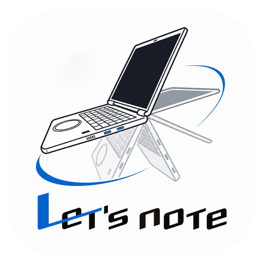

  

# 松下二合一平板电脑姿态管理工具

松下 Let's note QV 系列的 360° 翻转机型缺少检测开合角度的铰链传感器，因此没有原生的帐篷模式和支架模式。我们编写这个工具，就是为了在 Linux 上补齐这两种模式。

程序利用机身已有的加速度传感器和物理平板开关判断姿态，切换屏幕方向，并在帐篷、支架和平板模式下停用内置键盘和触控板。你也可以手动选择模式、设置切换提示或校准传感器。应用提供中英文界面，关闭窗口后会继续在后台管理姿态。

界面使用 Python/PyGObject 调用 GTK 4 和 libadwaita，保持独立的非特权进程，通过 D-Bus 与系统服务通信。

**当前版本：2.3.3**

## 支持范围

| 项目 | 支持范围 |
| --- | --- |
| 设备 | 重点支持 Panasonic CFQV8、CFQV9、CFQV1。其他 360° 翻转本按硬件能力判断兼容性，可用功能因设备而异。 |
| 桌面 | x86_64 Linux 上的 GNOME Wayland 和 KDE Plasma 6 Wayland。X11、Plasma 5 和其他 Wayland 桌面不在支持范围内。 |
| 安装包 | Arch Linux、Ubuntu 24.04+／Debian 13+ 和 Fedora 稳定版。 |

## Windows 界面预览

新增使用 Python、PyQt6 和 Fluent Widgets 的独立界面预览。窗口沿用 Linux 端的横向
Let’s note 标志与 500×660 简洁布局，强调色采用标志中的蓝色；底部切换姿态主页和设置页，
关于信息收在设置中。标题栏保留清晰的小尺寸横向标志，底部用居中的圆角矩形切换栏。
设置页将同类选项排在一个圆角面板内，用细线分行，标题与说明使用深浅两级中性灰，支持触屏拖动与惯性滚动。
提供模式选择、自动模式设置、校准交互、中英文和深浅主题。默认启动显示后台服务尚未接入；使用
`--demo` 可以演示模式切换、姿态确认、物理平板限制、等待、故障和断线状态。
演示数据只存在于窗口内，不会旋转屏幕、停用输入设备或保存系统设置。

Windows 后端和安装包尚未提供，预览不代表 Windows 设备支持。
从源码启动的方法见 [Windows 界面预览](USAGE.md#windows-界面预览)。

## 安装并打开

1. 下载与系统匹配的安装包。Arch Linux 也可从 AUR 安装。 [下载页面](https://github.com/adogecheems/panasonic-posture-manager/releases) · [安装命令](USAGE.md#安装)
2. 安装后注销并重新登录，让姿态管理随桌面会话启动。
3. 从应用菜单打开「松下二合一平板电脑姿态管理工具」。默认使用自动模式。

## 选择模式

打开「设置 → 模式选择」即可手动切换，也可随时选回「自动」。
使用键盘时，按方向键浏览模式，按空格键确认。主页会显示故障原因和下一步操作。
主页插画沿用应用图标的圆角机身和圆形触控板，以折叠角度区分姿态。屏幕中的问号表示姿态暂未确定。
正常切换由插画和标题反馈；等待超过两秒时才显示提示。姿态暂时未确定时不显示暂停提示，程序会自动继续判断。
设备的物理平板开关优先于软件选择。
进入物理平板模式时，程序保留当前屏幕方向，由桌面自动旋转接手，不会先恢复正向。
退出时，程序在正常的姿态判定期间短暂锁定开始等待时的方向，窗口内检查并纠正方向偏移，
等待稳定后直接转到目标方向；
锁定后会重新核对实际屏幕方向，纠正交接期间桌面自动旋转造成的偏差，再确认切换完成。
等待窗口最多两秒，超时或发生故障时恢复桌面设置。等待期间保留平板插画。
从已接管的帐篷、支架或软件平板进入物理平板再退出时，程序还会在这段交接中保留
桌面的平板显示状态，避免首次识别物理开关后先回正、再翻到帐篷方向。
退出后的保护最多两秒，不会因重复状态更新延长；期间桌面可能继续禁用内置键盘和触控板。
直接以原生平板状态启动时，继续由桌面处理物理开关。
姿态等待期间继续使用共享采样，避免在退出平板和进入支架之间反复切换传感器读取方式。
帐篷与支架之间翻转时，识别到另一种姿态后会等待其稳定确认，再直接切换屏幕方向，
避免在确认期间短暂切回笔记本、反复启停内置键盘和触控板。
如果转回笔记本姿态或发生故障，程序仍会撤销接管。

姿态处理故障时，后台会撤销软件输入接管，并尝试恢复桌面显示设置。
故障清理在后台执行，界面仍可读取状态。恢复记录损坏不会阻止后台启动，
但原来的屏幕方向和方向锁可能需要手动调整。
慢的显示操作期间，后台仍会维护会话连接；点击「重试」也会在后台处理。
撤销接管时会保留你在桌面设置里更改的方向锁或自动旋转策略。
只启用外接屏幕时，程序默认保留外接屏幕的方向。

| 模式 | 屏幕方向 | 内置键盘和触控板 |
| --- | --- | --- |
| 自动 | 随识别到的姿态切换 | 随模式切换 |
| 笔记本 | 正常横屏 | 启用 |
| 帐篷 | 倒置横屏（180°） | 停用 |
| 支架 | 正常横屏 | 停用 |
| 平板 | 由桌面环境管理自动旋转 | 停用 |

### 帐篷模式和切换提示

在「设置 → 自动模式」可关闭「启用帐篷模式」。关闭后，程序会退出当前帐篷模式，并停用自动切换和手动选择帐篷模式。

帐篷模式提示默认开启，支架模式提示默认关闭。启用提示后，从笔记本姿态翻到对应姿态并保持稳定，系统会询问是否切换。稳定和进入等待均以实际收到的传感器样本时间为准；采样暂时中断时，不会仅因等待时间到了就弹出新提示。
已经稳定回到笔记本姿态后，再翻到帐篷仍会重新询问，即使两次切换相隔不到五秒。
锁屏时会隐藏提示，解锁后仍有效的提示可再次弹出。调整角度时，暂时无法确认的提示会收起。
设备重新稳定在可确认的姿态后，可在应用主页确认同一次提示；持续可确认一秒后，被程序收起的通知会重新弹出。重新从笔记本姿态翻到目标姿态时会弹出新通知。

### 校准传感器

将设备保持在笔记本姿态，把底座平放在水平、稳定的桌面上，静置约 2 秒。
打开「设置 → 传感器」，点击「校准」并确认。要撤销校准，点击「恢复默认」。

### 锁屏后唤醒

帐篷、支架和软件平板接管期间，新增触摸唤醒路径：触摸屏幕后，当前会话请求发送
专用唤醒事件，保持原来的姿态和锁屏，随后可使用桌面的屏幕键盘解锁。
此路径用于系统仍在运行、仅屏幕关闭的情况；真正挂起后仍由系统处理唤醒和姿态重建。
触摸屏缺失、不可读取或有多个候选时停用此路径。该功能已通过隔离测试，尚未完成真机验证，
实际点亮和锁屏键盘行为仍需在目标桌面及设备上确认。

## 常见问题

| 现象 | 处理方法 |
| --- | --- |
| 后台服务未连接 | 重新打开应用。若刚安装或升级，注销并重新登录。仍有问题时查看[服务状态和日志](USAGE.md#排查)。 |
| 屏幕方向没有变化 | 若主页显示「重试」，点击后再试。连接外接显示器时，关闭镜像并检查屏幕排列。 |
| 帐篷或支架提示没有出现 | 确认对应提示已开启，再从笔记本姿态翻到目标姿态并保持稳定。 |
| 内置键盘或触控板没有恢复 | 将设备翻回笔记本姿态，并在设置中选回「自动」。仍未恢复时，注销并重新登录。 |
| 平板模式未被识别 | 将设备完整折叠、展开一次。 |

构建、发布及卸载说明见[安装、打包与运维](USAGE.md)。

## 许可

本项目采用 GNU Affero General Public License v3.0 或更高版本（`AGPL-3.0-or-later`）。 [许可证全文](LICENSE)
