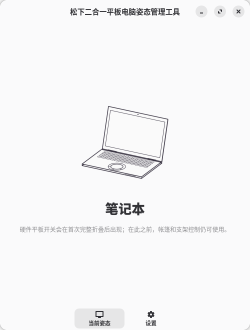

# 松下二合一平板电脑姿态管理工具

在 Linux 翻转本上自动切换屏幕方向和内置输入，重点支持 Panasonic QV 系列。
关闭窗口后继续在后台运行。

> **当前版本：2.0.0。** 支持 Arch Linux 上的 GNOME Wayland 和 KDE Plasma 6
> Wayland。



## 功能

- 自动识别笔记本、帐篷、支架和平板姿态。
- 自动模式以传感器识别姿态为准；手动选择只改变输出模式。
- 帐篷和支架模式可选二次确认，减少误触发。
- 硬件平板开关优先于软件设置。
- 支持传感器方向校准，可随时恢复默认。
- 提供中文、英文界面，跟随系统深浅色主题。

## 支持范围

- **设备**：Panasonic CFQV8、CFQV9、CFQV1；其他 360° 翻转本按硬件
  能力兼容，但不保证全部功能可用。
- **系统**：Arch Linux x86_64，GNOME Wayland 或 KDE Plasma 6 Wayland。
- **验证进度**：QV8 已通过主要功能实测；QV9/QV1 和 Plasma 6 仍待逐机验收。

暂不支持 X11、Plasma 5 和其他 Wayland 桌面。

## 安装

AUR 包尚未发布。当前请从源码安装；完成后注销并重新登录。

<details>
<summary>从源码安装</summary>

需要 Arch Linux、`base-devel` 和网络连接。

```sh
git clone --branch v2.0.0 --depth 1 \
  https://github.com/adogecheems/panasonic-posture-manager.git
cd panasonic-posture-manager/packaging/aur
makepkg -si
```

AUR 包发布后，也可直接安装 `panasonic-posture-manager`。

</details>

首次使用时，建议将设备完整折叠、展开一次。

## 使用

| 模式 | 适用场景 | 效果 |
| --- | --- | --- |
| 自动 | 日常使用 | 根据设备姿态自动切换 |
| 笔记本 | 打字、精细操作 | 横屏，内置键盘和触控板可用 |
| 帐篷 | 观影、触控 | 旋转 180°，停用内置键盘和触控板 |
| 支架 | 桌面观看、触控 | 保持横屏，停用内置键盘和触控板 |
| 平板 | 手持、平放 | 交给系统自动旋转，停用内置键盘和触控板 |

模式切换后立即生效。硬件平板开关打开时，以硬件状态为准。

帐篷提示默认开启，支架提示默认关闭，可在设置中修改。提示可通过桌面通知或
程序窗口确认；锁屏时不显示，解锁后若姿态仍合适会再次提示。

当前姿态始终显示传感器识别结果；服务启动时已处于帐篷或支架会直接采用该结果。
手动选择不改变姿态来源，只有从已识别的笔记本姿态进入帐篷或支架时才可能提示。

校准传感器时，将设备以笔记本形态平放在坚硬、水平的桌面上，保持约 2 秒，
再到“设置 → 传感器”点击“校准”。需要撤销时点击“恢复默认”。

## 常见问题

**后台服务未连接**：重新打开程序；仍然无效时注销并重新登录，或重启电脑。

**屏幕方向没有变化**：先点击“重试”。使用外接显示器时，请关闭镜像并检查
显示器排列。

**帐篷或支架提示没有出现**：确认提示已开启，并让设备保持稳定；提示通常只在
从笔记本姿态进入目标姿态时出现。

**内置键盘或触控板没有恢复**：在设置中选择“自动”；仍然无效时注销并重新登录。

**平板模式没有被识别**：将设备完整折叠、展开一次。

更多排查方法见 [安装、打包与运维](packaging/aur/README.md)。

## 已知限制

- QV8 的最终物理验收、QV9/QV1 同族回归和 Plasma 6 Wayland 真机验证尚未完成。
- 其他品牌和未适配机型可能无法使用全部传感器或输入控制功能。
- 程序判断的是设备底座方向，不是铰链角度；少数摆放方式可能归入相近模式。
- 外接显示器布局冲突时，屏幕旋转可能被系统拒绝；硬件平板模式下的自动旋转
  取决于设备固件和桌面环境。

## 卸载

从包管理器卸载 `panasonic-posture-manager`。设置和校准数据的清理方法见
[安装、打包与运维](packaging/aur/README.md)。

## 更多文档

- [更新日志](CHANGELOG.md)
- [机型适配说明](docs/hardware-profiles.md)
- [实机验证记录](docs/hardware-validation.md)
- [安装、打包与运维](packaging/aur/README.md)

## 许可

本项目采用 GNU Affero General Public License v3.0 或更高版本
（`AGPL-3.0-or-later`），详见 [LICENSE](LICENSE)。
